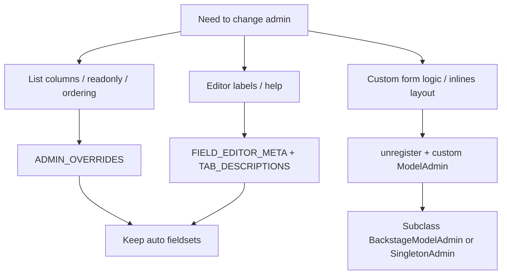

# Customization cookbook

Choose the **smallest** tool that works.



## 1. `ADMIN_OVERRIDES` (preferred for lists)

In **`yourapp/backstage_host.py`**, keyed by **model class name** (PascalCase). See [examples/backstage_host.example.py](../examples/backstage_host.example.py).

```python
ADMIN_OVERRIDES = {
    "BlogPost": {
        "list_display": ["title", "is_published", "published_at"],
        "list_display_links": ["title"],
    },
    "ContactInquiry": {
        "readonly_fields": ["name", "email", "message", "created_at"],
    },
}
```

Pass via `BACKSTAGE["ADMIN_OVERRIDES"]`. Factory applies with `setattr` on the generated admin class.

**Submissions:** keep PII readonly here — not in package config.

### Changelist UX flags (on generated or custom admin)

| Attribute | Default | Purpose |
|-----------|---------|---------|
| `changelist_row_edit` | True | Icon link to change view |
| `changelist_row_delete` | True | Delete confirmation link |
| `changelist_editable_ux` | True | Hint strip when `list_editable` set |

Set `changelist_editable_ux = False` to hide hint only.

## 2. Editor metadata

Host module: **`yourapp/backstage_host.py`** (`FIELD_EDITOR_META`, `TAB_DESCRIPTIONS`).

## 3. Navigation and icons

| Key | Example |
|-----|---------|
| `NAV_GROUPS` | Group apps under Website / Content / System |
| `MODEL_ICONS` | `"blogpost": "newspaper"` |
| `MODEL_LABELS` | Override sidebar plural label |

## 4. Unregister / re-register

Required when `@admin.register` would double-register (Backstage already registered the model).

```python
# core/admin.py — loaded after Backstage ready + autodiscover
from django.contrib import admin
from backstage.registry.base import BackstageModelAdmin
from core.models import BlogPost

@admin.register(BlogPost)
class BlogPostAdmin(BackstageModelAdmin):
    # preserve mixins for editor meta + rich text
    pass
```

**Wrong:** `@admin.register(BlogPost)` without unregister → `AlreadyRegistered`.

**Right:**

```python
admin.site.unregister(BlogPost)
admin.site.register(BlogPost, BlogPostAdmin)
```

Or in `AppConfig.ready()` (same unregister/register pattern).

## 5. Full manual nav

Set `BACKSTAGE["SIDEBAR"]["navigation"]` to a non-empty manual nav list to replace auto-built sidebar.

## 6. Skip autodiscover for an app

`BACKSTAGE["SKIP_APP_LABELS"] = ["contenttypes", "sessions", "admin", "my_legacy_app"]` then register those models manually if needed.

## 7. SEO / rich text conventions

Override `SEO_FIELD_NAMES`, `RICH_TEXT_FIELD_NAMES`, or `RICH_TEXT_SUFFIXES` without touching factory code.

## 8. Dashboard home

Configure `BACKSTAGE["DASHBOARD"]` for the admin index (welcome, stat cards, quick actions, my drafts, recent activity). Set `DASHBOARD.enabled` to `false` to restore the legacy Django app list home.

Optional **`welcome.links`**: list of `{ "label", "url" }` or `{ "label", "url_key": "frontend" }` or `{ "label", "model", "action", "singleton" }` for admin URLs (resolved at render time).

- **Stat counts:** `filter` on a model, or `count_callback` import path `(request, admin_site) -> int`.
- **Full page override:** `BACKSTAGE["DASHBOARD_TEMPLATE"] = "yourapp/admin/dashboard.html"` (context still includes `dashboard_widgets`, `dashboard_layout`).
- **Extra context:** `DASHBOARD_CALLBACK` runs after widgets are built.

See [reference/configuration.md](reference/configuration.md) for the full `DASHBOARD` schema.

Default dashboard markup and styling live in `backstage/templates/backstage/dashboard/` and [`admin-theme.css`](../../../backstage/static/backstage/admin-theme.css). For a completely different layout, set `DASHBOARD_TEMPLATE` to your own template (context keys `dashboard_widgets`, `dashboard_layout` remain available).

The welcome block always includes a **Material `waving_hand`** icon with a subtle CSS wave (disabled when the user prefers reduced motion).

After theme changes, smoke-test in light/dark: `/admin/`, a changelist, change + add forms, and a preview-split edit page; confirm `prefers-reduced-motion` disables welcome icon animation.

## 9. Design tokens (`admin-theme.css`)

Shared layout tokens live in `:root` in [`admin-theme.css`](../../../backstage/static/backstage/admin-theme.css). Prefer these over one-off Tailwind heights in new templates.

| Token | Default | Used for |
|-------|---------|----------|
| `--backstage-control-min-height` | `2.25rem` | Buttons (`.backstage-control`), search shell, filter facets (`.backstage-control-height`) |
| `--backstage-footer-bar-min-height` | `56px` | Sticky submit row, sidebar user strip (`.backstage-footer-bar`) |
| `--backstage-footer-bar-padding-block` | `0.5rem` | Footer bar vertical padding |
| `--backstage-table-header-height` | `2.25rem` | `.backstage-table thead th` |
| `--backstage-table-cell-padding-y` / `-x` | `0.5rem` / `1rem` | `.backstage-table` body cells (single source; not duplicated in `TABLE_CELL_CLASSES`) |
| `--backstage-row-action-size` | `1.75rem` | Changelist Edit/Delete/More (`.backstage-row-action`) |
| `--backstage-border` / `--backstage-surface` | theme | Dashboard cards, popovers, dividers |

Changelist **empty state** inside `.changelist-card` has no inner border (toolbar provides the divider). Dataset empty states keep a framed panel via template classes when `cl.is_dataset`.

**Buttons:** In `#main`, `#main .backstage-control` applies a uniform `min-height` from `--backstage-control-min-height`. The `size="md"` / `size="lg"` classes on [`button.html`](../../../backstage/templates/backstage/components/button.html) mainly adjust padding; effective height stays sm-equivalent unless you change the global token or relax that rule.

**Charts:** Use `` or `` with a `.chart` canvas; Chart.js loads lazily when a chart is present (see [`skeleton.html`](../../../backstage/templates/backstage/layouts/skeleton.html) `data-chart-script`).

## 10. When to subclass the factory admin

Import pattern:

```python
from backstage.registry.factory import build_admin_class
BlogPostAdmin = build_admin_class(BlogPost)
```

Extend that class if you need one-off methods while keeping auto fieldsets/inlines.

## Host file patterns

| Use case | Where |
|----------|--------|
| List columns / readonly submissions | `ADMIN_OVERRIDES` in `backstage_host.py` |
| Editor labels and tab intros | Same file |
| Preview paths | `resolve_preview_route` in same file |
