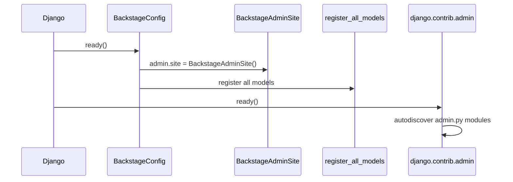

# Auto-admin behavior

## Startup sequence

1. **`backstage/apps.py`** — `BackstageConfig.ready()` assigns `BackstageAdminSite` to `admin.site`.
2. **`register_all_models()`** — for each model, `build_admin_class()` + `admin.site.register()` unless skipped or already registered.
3. **`django.contrib.admin`** — imports `yourapp/admin.py` for manual overrides (must unregister before re-register).

## `should_skip_model`

| Condition | Skipped |
|-----------|---------|
| Abstract or unmanaged | Yes |
| `BackstageSettings`, `Permission` | Yes |
| App in `SKIP_APP_LABELS` | Yes |
| Proxy model | Yes |
| Inline-only (single FK, same app) | Yes |

Default skip labels: `contenttypes`, `sessions`, `admin`.

## Factory output (`build_admin_class`)

| Input signal | Admin attribute / behavior |
|--------------|----------------------------|
| `SingletonModel` in MRO | Base class `SingletonAdmin` |
| Else | `BackstageModelAdmin` |
| Editable fields | Auto `fieldsets`: Content, Publishing, SEO tabs |
| Reverse FKs | `inlines` — stacked, tabbed |
| Rich text fields | `rich_text_fields` tuple |
| Preview route on blank instance | `preview_enabled = True` |
| `slug` + `title` | `prepopulated_fields` |
| FK `product` | `autocomplete_fields` |
| Model name | `ADMIN_OVERRIDES` merged via `_apply_admin_overrides` |

### List display heuristics

- Prefer link on `title`, `name`, `text`, `label`, `heading`, `slug`.
- Deprioritize booleans, files, `order`, raw images from default columns.
- Append **Actions** column (edit, delete, kebab) when permissions allow.

### Auto excluded from forms/lists where noted

`id`, `created_at`, `updated_at`, `created_by`, `updated_by` — excluded from default list/filter heuristics as `AUTO_FIELD_NAMES`.

## `SingletonAdmin`

| Feature | Behavior |
|---------|----------|
| `has_delete_permission` | Always `False` |
| `changelist_view` | Redirect to `1/change/` |
| `has_add_permission` | False when a row exists |
| `_ensure_singleton` | `get_or_create(pk=1)` |

## `BackstageModelAdmin` mixins (order)

1. `EditorMetadataMixin` — `FIELD_EDITOR_META`
2. `RichTextAdminMixin` — TinyMCE widget on `rich_text_fields`
3. `ModelAdmin` — Backstage base

Inlines use `EditorMetadataMixin` + `RichTextInlineMixin`.

## User and Group

Special-cased in factory with Django auth forms and custom fieldsets; still wrapped with `ADMIN_OVERRIDES`.

## No `admin.py` required

Host apps may keep empty `admin.py` with a comment only. Customization paths: [../features/customization.md](../features/customization.md).
