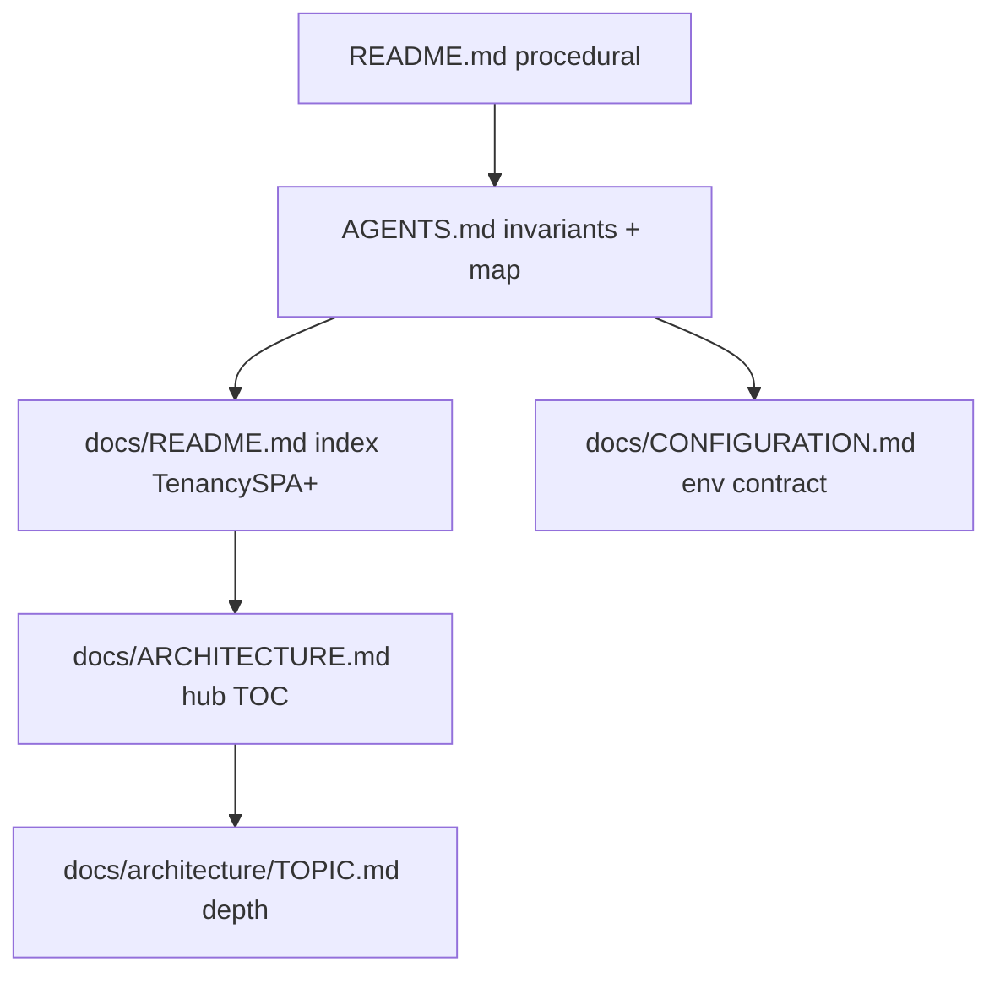

# Repository documentation standard

How every Django API (and its sibling SPA) should structure docs so humans and AI agents find answers once.

**This file** covers layout and conventions. **Environment and Docker** for new projects start from [CONFIGURATION.md](CONFIGURATION.md) in django-template—**copy** that file into each product repo (`docs/CONFIGURATION.md`) and edit in place. Monorepo sibling paths are optional, not required.

---

## Who reads what

| Reader | Start here | Then |
|--------|------------|------|
| Human (clone, run, deploy) | Repo `README.md` | `AGENTS.md` for invariants; [CONFIGURATION.md](CONFIGURATION.md) for env |
| Cursor / agents | Repo `AGENTS.md` | `docs/README.md` (if present) → [CONFIGURATION.md](CONFIGURATION.md) → `docs/ARCHITECTURE.md` hub |
| Backstage CMS host | [docs/backstage/README.md](backstage/README.md) | [integration.md](backstage/integration.md); orthogonal to most SPAs |

**Read order for a new product backend:**



---

## Standard tree (Django API)

```text
<product>-backend/
  README.md                 # Install, run, deploy — link AGENTS.md once
  AGENTS.md                 # Required: tenancy, layers, commands, app map, links
  .env.example              # Same section order as CONFIGURATION.md
  docs/                     # Tenancy SPA+ (see tiers)
    README.md               # Index + read order
    CONFIGURATION.md        # Vendored env contract (copy from django-template)
    ARCHITECTURE.md         # Hub: product context + links to topic files
    architecture/           # Topic depth (UPPERCASE.md e.g. SITES.md, PLANS.md)
    <policy>.md             # e.g. qa-quick-login.md
    MAP.md                  # Heavy tier only (Homesteadr extended index)
  demo_*/                   # Optional: README + QA.md for seeds
  packages/<name>/README.md # Optional: publishable/vendored packages only
```

### Do not add

- `<django-app>/ARCHITECTURE.md`, `<django-app>/AGENTS.md` — use `docs/architecture/<TOPIC>.md` and link from the hub.
- `work/README.md`, `crm/README.md`, or per-Django-app READMEs (use app `module.py` docstrings + tests).
- A full product spec or Blueprint compiler guide in `docs/` unless you maintain that product.
- Paragraphs that repeat [CONFIGURATION.md](CONFIGURATION.md) (Postgres external, Redis indexes, compose rules).

### Frontend sibling

Mirror the same hub + topic pattern (thinner than backend — no vendored `CONFIGURATION.md` on the SPA):

```text
<product>-frontend/
  README.md                 # Dev server, env, API URL, auth cookies
  AGENTS.md                 # features/* layout, link to backend AGENTS.md + docs
  docs/
    README.md               # Index + read order (Tenancy SPA / marketing template)
    ARCHITECTURE.md         # Hub: local topics + link to backend hub
    architecture/           # Local depth only (UI patterns, FSD, product UI)
    optional/               # Marketing template only (see reactjs-ts-template)
```

Reference for marketing SPAs: [`../reactjs-ts-template/docs/README.md`](../reactjs-ts-template/docs/README.md). Tenancy SPA frontend reference: [MemBlue frontend](../../../memblue/memblue-frontend/docs/README.md).

### Canonical `docs/architecture/` topic filenames

Use these **slot names** for cross-repo consistency. Hub tables use human labels; files use the names below.

| Slot | File | When |
|------|------|------|
| SPA structure playbook | `architecture/APP_STRUCTURE.md` | React SPA: FSD layers, router, RTK Query |
| UI conventions | `architecture/UI_PATTERNS.md` | Optional office / shared component rules |
| Demo / QA runbook | `architecture/QA_DEMO.md` | Optional; never production. Operator steps + product-specific sections (e.g. seed package layout) in **one** file — no `demo_*/QA.md` or demo-app READMEs |
| Product domain | `architecture/<DOMAIN>.md` | Backend or cross-cutting depth (e.g. `SITES.md`) |
| Bootstrap stub | `architecture/EXAMPLE_TOPIC.md` | Copy/rename when adding a new topic |

---

## Product tiers (how much `docs/` to carry)

Pick one tier when adopting this standard; do not force every repo to look like the heaviest.

| Tier | Example | `AGENTS.md` | Extra `docs/` |
|------|---------|-------------|----------------|
| **Minimal** | CondHOA | Commands, layout, link template CONFIGURATION.md | `docs/qa-*.md` or similar |
| **Tenancy SPA** | MemBlue | Tenancy header, frontend contract, app map | **Backend:** `docs/README.md`, vendored `docs/CONFIGURATION.md`, hub, `docs/architecture/*.md`. **Frontend:** `docs/README.md` + hub + local topics; API depth on backend hub |
| **Heavy** | Homesteadr | Conventions + link MAP/ARCHITECTURE | Above + `docs/MAP.md`, `docs/ecosystem/`, runbooks — `docs/README.md` should point at MAP first |

**Homesteadr** uses `docs/MAP.md` plus hub `docs/ARCHITECTURE.md`; core backend depth lives in `docs/architecture/CORE.md` (not in the hub file).

MemBlue keeps `docs/README.md` self-contained (no link to this playbook from the product repo); monorepo maintainers open `project-documentation.md` here when adopting the standard.

**Adoption:** Align existing repos incrementally. Do not delete Homesteadr-style architecture docs to “simplify”; link this playbook and trim duplicate Docker bullets in `AGENTS.md` instead.

---

## When to add architecture docs

| Situation | Document? |
|-----------|-----------|
| CRUD app + services + ViewSet | **No** — describe in `AGENTS.md` map |
| Multiple hosts (API vs public site, CDN, SSR) | **Yes** — `docs/architecture/<TOPIC>.md` (e.g. `SITES.md`); hub links from `docs/ARCHITECTURE.md` |
| Whole-product architecture (many domains) | **Heavy tier** — `docs/MAP.md` + hub `docs/ARCHITECTURE.md` (Homesteadr) |
| Backstage admin host | **No** separate product ARCHITECTURE — use [docs/backstage/](backstage/) |
| Access / RBAC | **No** — registry + `*/module.py`; one bullet in `AGENTS.md` |
| `<django-app>/ARCHITECTURE.md` or `<app>/AGENTS.md` | **Do not** — `docs/architecture/<TOPIC>.md` + root `AGENTS.md` only |
| Doc grew past ~400 lines or unrelated topics | Split topics under `docs/architecture/`; keep hub as TOC |

---

## Blueprint (MemBlue / 901levee-style products)

Runtime business config lives in code: compiled `BlueprintVersion`, pack appliers, `blueprint/memblue.py` (or product equivalent), and `*/module.py` grant registration. The Blueprint can override roles via `roles.grant_overrides`.

Do **not** add `docs/BLUEPRINT.md` unless you are documenting a compiler product for external readers. Product-specific policy belongs in `AGENTS.md` bullets or a short optional `docs/<topic>.md` when needed.

**Follow-up on product repos:** document API shapes in **`docs/ARCHITECTURE.md`** (hub) and **`docs/architecture/<TOPIC>.md`** (depth); retarget code docstrings to those paths.

**Reference implementation:** [MemBlue backend](../../../memblue/memblue-backend) and [MemBlue frontend](../../../memblue/memblue-frontend) are filled-in Tenancy SPA trees. Copy stubs below when bootstrapping; do not symlink.

---

## Tenancy SPA bootstrap (copy from django-template)

From your new `<product>-backend/` (adjust `TEMPLATE` to this repo path):

```bash
TEMPLATE=../../starter-template/django-template   # monorepo example
mkdir -p docs/architecture
cp "$TEMPLATE/docs/README.md" docs/
cp "$TEMPLATE/docs/ARCHITECTURE.md" docs/
cp "$TEMPLATE/docs/CONFIGURATION.md" docs/
cp "$TEMPLATE/docs/architecture/EXAMPLE_TOPIC.md" docs/architecture/<TOPIC>.md
```

Then:

- Replace `[Product]` placeholders in `docs/README.md` and the hub intro in `docs/ARCHITECTURE.md`.
- Add a row per topic in the hub table; expand each `docs/architecture/<TOPIC>.md`.
- Root **`AGENTS.md`**: Documentation bullets → `docs/README.md`, hub, vendored `docs/CONFIGURATION.md` (see copy-paste stub below).
- Root **`README.md`**: one line → `docs/README.md` (see copy-paste stub).
- **Do not** copy `docs/architecture/BACKSTAGE.md` unless you are a Backstage CMS host (django-template only).
- **Optional:** if the product has QA quick-login or demo seed, `cp "$TEMPLATE/docs/architecture/QA_DEMO.md" docs/architecture/` and customize (see [MemBlue](../../../memblue/memblue-backend/docs/architecture/QA_DEMO.md) or [CondHOA](../../../condhoa/condhoa-backend/docs/architecture/QA_DEMO.md); add hub + AGENTS links).

Stub sources in this repo: [docs/README.md](README.md), [docs/ARCHITECTURE.md](ARCHITECTURE.md), [docs/architecture/EXAMPLE_TOPIC.md](architecture/EXAMPLE_TOPIC.md).

---

## Marketing SPA bootstrap (copy from reactjs-ts-template)

From your new `<product>-frontend/` (adjust `FE_TEMPLATE`):

```bash
FE_TEMPLATE=../../starter-template/reactjs-ts-template   # monorepo example
mkdir -p docs/architecture
cp "$FE_TEMPLATE/docs/README.md" docs/
cp "$FE_TEMPLATE/docs/ARCHITECTURE.md" docs/
cp "$FE_TEMPLATE/docs/architecture/APP_STRUCTURE.md" docs/architecture/
cp "$FE_TEMPLATE/docs/architecture/EXAMPLE_TOPIC.md" docs/architecture/<TOPIC>.md
cp "$FE_TEMPLATE/AGENTS.md" ./AGENTS.md   # then customize [product] placeholders
```

Then:

- Replace `[Product]` in `docs/README.md` and the hub intro in `docs/ARCHITECTURE.md`.
- Customize `docs/architecture/APP_STRUCTURE.md` or replace with product-specific topics.
- Root **`README.md`**: Documentation index → `docs/README.md` (see [reactjs-ts-template README](../../reactjs-ts-template/README.md)).
- Pair with django-template or product backend; env contract stays on the API repo.

Stub sources: [reactjs-ts-template/docs/README.md](../../reactjs-ts-template/docs/README.md), [ARCHITECTURE.md](../../reactjs-ts-template/docs/ARCHITECTURE.md), [APP_STRUCTURE.md](../../reactjs-ts-template/docs/architecture/APP_STRUCTURE.md).

---

## Tenancy SPA frontend bootstrap

Lighter than backend — **do not** copy `CONFIGURATION.md` into the SPA repo.

1. Add **`docs/README.md`** and **`docs/ARCHITECTURE.md`** (author in-product or copy hub stubs from django-template and trim backend-only rows).
2. Root **`AGENTS.md`**: link `docs/README.md`, hub, and sibling backend `docs/README.md` / `docs/architecture/*` (see copy-paste frontend stub).
3. Root **`README.md`**: one line → `docs/README.md`.
4. Put **API / domain depth** on the backend hub (`docs/architecture/SITES.md`, etc.). Optional frontend slots: `APP_STRUCTURE.md`, `UI_PATTERNS.md`. Optional backend QA: `QA_DEMO.md`.

Filled example: [memblue-frontend/docs/README.md](../../../memblue/memblue-frontend/docs/README.md).

---

## New project checklist

1. Start from [django-template](../) or clone an existing `office/<product>/<product>-backend`.
2. Add or refresh **`AGENTS.md`** using the stub below (invariants, map, commands).
3. Keep **`README.md`** procedural; one line pointing to `AGENTS.md` and [CONFIGURATION.md](CONFIGURATION.md).
4. Add **`docs/`** only when you need ecosystem IDs, legacy naming, QA gates, or deploy notes not suitable for README.
5. For Tenancy SPA tier, run **[Tenancy SPA bootstrap](#tenancy-spa-bootstrap-copy-from-django-template)** (or step 5 when you need multi-host, CDN, or large topic docs).
6. For **Backstage CMS** sites, follow [guides/copy-to-new-project.md](backstage/guides/copy-to-new-project.md) in addition to this file.

### Linking from `office/<product>/<product>-backend`

Typical relative paths to this playbook and env contract:

```text
../../starter-template/django-template/docs/project-documentation.md
../../starter-template/django-template/docs/CONFIGURATION.md
```

Adjust `../` depth if the repo layout differs.

---

## Copy-paste: `AGENTS.md` (product backend)

Replace `[product]` and fill bracketed sections. Keep under ~120 lines.

```markdown
# Agent guide — [product]-backend

Django X + DRF. SPA: sibling `[product]-frontend`.

## Documentation

- **Index:** [docs/README.md](docs/README.md)
- **Architecture hub:** [docs/ARCHITECTURE.md](docs/ARCHITECTURE.md)
- **Env, settings, Docker:** [docs/CONFIGURATION.md](docs/CONFIGURATION.md)
- **Deploy:** [README.md](README.md)
- [Optional: demo_*/QA.md, docs/qa-*.md]

## Commands

```bash
uv sync && uv run python manage.py check && uv run pytest -q
```

## Invariants

- [Tenancy: none | Tenant + header | org model]
- [Auth: JWT, cookies, MFA, demo flags]
- Layers: Model → services → ViewSet; `transaction.atomic()` for multi-step writes.

## Map

- Settings / URLs: `app/settings.py`, `app/urls_api.py`
- [5–15 bullets: areas agents confuse]

## Frontend contract

- New APIs need a caller in `[product]-frontend` `features/*` OR document as backend-only.
- [Drift check script or OpenAPI regen if applicable]

## Subsystems

- [Optional: docs/architecture/TOPIC.md — link from hub, not from django-app folders]
```

---

## Copy-paste: `README.md` (product backend)

```markdown
# [Product] Backend

[One paragraph: what this API is.]

Agent docs: [AGENTS.md](AGENTS.md). Documentation index: [docs/README.md](docs/README.md).

[Minimal tier: link vendored or template CONFIGURATION.md instead of a full docs/ tree.]

## Local

[cp .env.example, migrate, runserver, docker compose — procedural only]
```

---

## Copy-paste: `AGENTS.md` (product frontend)

```markdown
# Agent guide — [product]-frontend

Vite + React SPA. API: sibling `[product]-backend`.

## Documentation

| Topic | Document |
|-------|----------|
| Doc index + read order | [docs/README.md](docs/README.md) |
| Architecture hub (local topics) | [docs/ARCHITECTURE.md](docs/ARCHITECTURE.md) |
| Backend invariants | [../[product]-backend/AGENTS.md](../[product]-backend/AGENTS.md) |
| Backend doc index | [../[product]-backend/docs/README.md](../[product]-backend/docs/README.md) |
| API env / CORS / cookies | [../[product]-backend/docs/CONFIGURATION.md](../[product]-backend/docs/CONFIGURATION.md) |
| [Optional UI patterns] | [docs/architecture/UI_PATTERNS.md](docs/architecture/UI_PATTERNS.md) |

## Basics

- API base URL: `VITE_*` in `.env.example`
- [Tenancy header, auth cookie name, RTK Query / features/* layout]
```

---

## This repo (django-template)

**django-template** is the **reference host** for:

- [CONFIGURATION.md](CONFIGURATION.md) — shared env/Docker contract (products copy into `docs/CONFIGURATION.md`).
- [docs/README.md](README.md), [docs/ARCHITECTURE.md](ARCHITECTURE.md), [docs/architecture/EXAMPLE_TOPIC.md](architecture/EXAMPLE_TOPIC.md) — Tenancy SPA stubs to copy.
- [docs/backstage/](backstage/) — vendored Backstage admin; see [AGENTS.md](../AGENTS.md) in this repo.

Product SPAs (MemBlue office, CondHOA, etc.) use the same **configuration** doc but their own **AGENTS.md** content; they do not need Backstage docs unless they embed the CMS package.

---

## Follow-up when adopting on a product repo

| Item | Typical action |
|------|----------------|
| New product from template | Copy `docs/README.md`, `ARCHITECTURE.md`, `CONFIGURATION.md`, `architecture/EXAMPLE_TOPIC.md` → rename topics; see [Tenancy SPA bootstrap](#tenancy-spa-bootstrap-copy-from-django-template) |
| New marketing SPA from template | Copy `docs/README.md`, hub, `architecture/APP_STRUCTURE.md`, `EXAMPLE_TOPIC.md`, `AGENTS.md` from [reactjs-ts-template](../../reactjs-ts-template); see [Marketing SPA bootstrap](#marketing-spa-bootstrap-copy-from-reactjs-ts-template) |
| Missing architecture doc (code references) | Add `docs/architecture/<TOPIC>.md`; link from hub; retarget docstrings |
| CondHOA / Homesteadr | Add link to this file; dedupe Docker text in `AGENTS.md` |
| `office/docs/` hub | Optional monorepo index linking template + ecosystem READMEs |
| Frontends without `AGENTS.md` | Add short stub from above |
